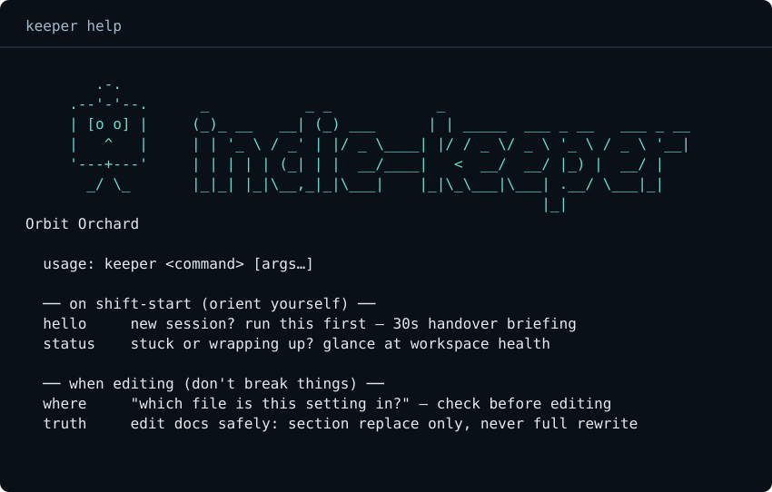
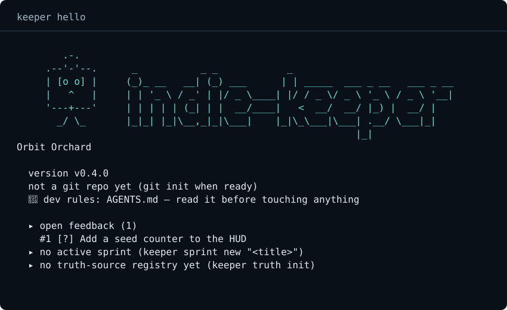
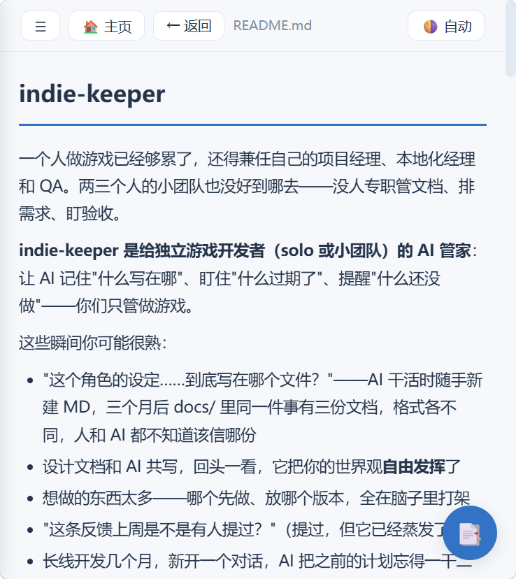
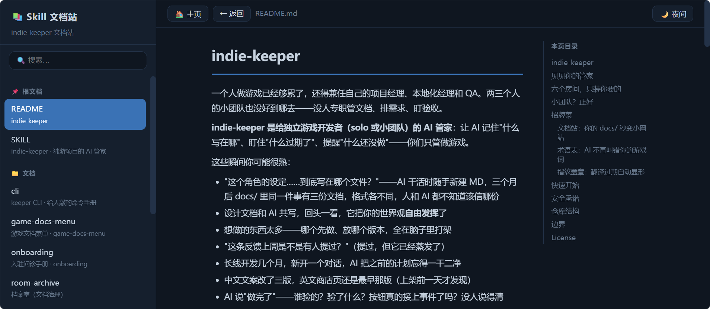

# indie-keeper

English | **[中文](docs/zh/README.zh.md)**

**indie-keeper** is an AI housekeeper **Skill** for indie game devs (solo or small team). It gives the AI a project-wide memory and a set of repeatable workflows — docs stay orderly, feedback has a paper trail, translations never silently rot, and releases have a rhythm. Seven independent rooms + a project skeleton + conventions baked into AGENTS.md, adopt only what you need. Zero dependencies (just Node.js) — the AI triages your repo first, then you can let it keep driving per the manuals, or use the same scripts as a plain CLI.

## Sound familiar?

Making a game solo is exhausting enough — you're also your own project manager, localization lead, and QA. A 2–3 person small team isn't much better: nobody owns the docs, the roadmap, or the sign-off. If any of these hit home:

- "Which file is this character's setting written in?" — the AI spins up a new MD whenever it works, and three months later docs/ has three files on the same thing, each formatted differently, and neither you nor the AI knows which one to trust
- You co-write a design doc with the AI, look back, and find it has **improvised** on your worldbuilding
- Too many ideas fighting in your head — which to do first, which version to put them in
- "Did someone file this feedback last week?" (They did, but it has already evaporated)
- Months of long-term dev, you start a new chat, and the AI has completely forgotten the previous plan
- Chinese copy went through three revisions, the English store page is still the earliest version (discovered the day before launch)
- The AI says "done" — who verified it? What was verified? Is the button actually wired to the event? Nobody can say

indie-keeper is built for exactly these.

## What it does

| Room | Solves | Key mechanism |
|------|--------|---------------|
| **Archive** | "Where is this setting written?" / AI edits clobber docs | Single source of truth registry + section-level safe edits + dead-link/untracked checks |
| **Feedback Box** | Feedback evaporates / plans live only in your head | Every feedback gets an ID and a paper trail; mature ideas flow into a versioned ROADMAP |
| **WIKI** | Too many docs to browse / rule files scattered | docs/ becomes a searchable mini website — bidirectional links, backlinks, night mode, single-file pack |
| **Docs Translation Desk** | Source changes, translations go stale, nobody notices | Content-fingerprint stamps surface stale translations; CI gate before release |
| **Game Text Desk** | Hardcoded in-game text / inconsistent terms | Scan for hardcoded strings, manage a glossary, detect translation drift per string |
| **Shipping Dock** | Version numbers drift / acceptance is verbal / releases are chaotic | One-click version sync across files + sprint acceptance with sign-off roles + release pipeline (preflight + changelog + platform guides) |
| **Schedule** | "When does this ship?" / plans without dates slip silently | Version dates + effort estimates; Gantt view renders inside the WIKI |

Three design principles run through every room: **triage first, build second** (never assume a "standard practice"); **progressive adoption** (seven rooms, independent); **conventions, not gates** (every flow is a default, not a checkpoint — if you say "just pass this one", the AI listens).

## Project skeleton & conventions

Beyond the seven rooms, triage also seeds a **project skeleton** — a small set of docs at the root and under `docs/` that orient newcomers (humans and AI alike) without making them grep the whole repo:

| Doc | Purpose |
|-----|---------|
| `AGENTS.md` | AI employee handbook (tech stack, file layout, conventions, traps) — any AI reads it first |
| `START-HERE.md` | Human entry page (what's new, pending decisions, document map) |
| `docs/PLAN.md` | Current + next sprint task list |
| `docs/PROGRESS.md` | Reverse-chronological progress log |
| `docs/DOCS-OVERVIEW.md` | Repo-wide document map + suggested reading order |
| `docs/ARCHITECTURE.md` | Technical architecture (modules / data flow / decisions) |
| `docs/UIUX-SPEC.md` | UI/UX architecture (design system / interaction / a11y) — opted out for pure-text/CLI projects |

Each can be opted out individually via `entryDocs.*` in the profile. The triage also establishes two **conventions** written into `AGENTS.md`: a **repo layout** convention (identity docs at root, status docs under `docs/`, scripts under `scripts/`) and a **testing** convention (naming + layering + maintenance rules tailored to the stack — indie-keeper does not ship a test runner, it just helps you set conventions that fit your stack).

## Quick start

**For AI use (recommended)**: drop this repo into your AI tool's Skill/rules directory (Claude Code's skills, Cursor's rules, etc. — anything that reads SKILL.md), then tell the AI:

> Use indie-keeper to manage my project

The AI triages first, then acts — never applies a one-size-fits-all template.

**As a CLI**: copy `scripts/` into your project (suggested `tools/keeper/`), register one line in package.json: `"keeper": "node tools/keeper/keeper.js"`. One round of triage is still needed before daily use — let the AI do it (recommended), or follow the onboarding manual by hand. Full CLI manual: [references/cli.md](references/cli.md).

Either way, first use is **triage**, not an install wizard: the AI asks about your division of labor, platforms, and habits (each question comes with a suggestion and a recommended default), and the answers go into `keeper-profile.json`, after which every room works the way you like. Domains marked with authority in the division-of-labor table (e.g. "worldbuilding — your call") are organized and implemented only by the AI, **never improvised**. Existing doc structures in old projects go through "renovation": inventory and register first, no bulldozing.

After triage, type `keeper` in a terminal to see your game's name and the commands for starting a shift.



The daily three:

```bash
keeper hello           # Type this first every time you start work: a 30-second shift handover. New chat forgot everything? This restores state instantly.
keeper where characters  # When lost: "which file is this setting written in?" — straight to the authoritative doc, no full-text search
keeper status          # A glance before bed: workspace health
```

A few more for housekeeping:

```bash
keeper progress add "shipped v0.3"   # append a line to docs/PROGRESS.md
keeper plan done P-2                 # mark a PLAN.md task ✅
keeper start-here refresh            # regenerate START-HERE.md's progress + doc-map sections from PROGRESS + truth-source
keeper schedule check                # catch duplicate ids / dangling deps / date inversions in schedule.json
```



Output defaults to English; `--lang zh` or `"language": "zh"` in the profile switches to Chinese.

## Small team? Even better

This is not solo-only — a 2–3 person small team gets more out of it:

- **Division of labor written into the archive**: triage registers who owns what ("worldbuilding — A's call, code — B's"), so the AI knows whose word to take and won't go editing A's setting with B's opinion
- **Requests have a source**: every feedback records who filed it (`--from art` / `--from playtest-group`); six months later when you ask "who wanted this in the first place" there's no archaeology
- **Sign-off has a role**: acceptance mode supports requiring a specific person's nod (`human`) or another AI's cross-check (`peer`); who verified stays on the record
- **Non-coding members can read the docs too**: `keeper site pack` packs all docs into **a single static HTML** you can drop in the group chat — designers, artists, writers can read it on their phones, with search and outline, nothing to install



## Signature features

### WIKI: your docs/ becomes a mini website

Run `keeper site serve`, and a full WIKI opens in the browser:

- **Bidirectional links + backlinks**: `[[wiki links]]` jump across docs, the backlinks panel shows "who references this one" — find related docs at a glance even in complex structures
- **Quick navigation**: the sidebar groups by real folders and collapses (locate docs no matter how many); pure-numeric filenames (like sprint) get auto-promoted to their title for display
- **On-page outline + search**: long docs auto-generate a right-side outline; full-text search filters the sidebar instantly
- **Images actually render**: local images display directly, `![[Obsidian embeds]]` are recognized; on `pack`, images get inlined as base64 so the offline single file still shows them
- **Day/Night/Follow-system** three-way color scheme (night is an eye-friendly dark blue), top bar `🌐 中文` to switch language in one click

`keeper site pack` packs the whole site into **one HTML file** — drop it in the group chat and even phones can read it.



**Fully Obsidian-compatible**: `[[bidirectional links]]`, `[[target|display name]]`, frontmatter, `![[embeds]]` all use Obsidian's syntax. Write and manage in Obsidian, send others the WIKI — switch freely, zero migration cost.

The AI rule files in the project (`AGENTS.md`, `CLAUDE.md`, `.cursorrules`...) are auto-collected and pinned to the top — the AI employee handbook belongs at the door.

### Glossary: the AI stops misnaming your game's words

In your game, the action resource isn't called stamina, it's called **Soul**? The glossary is "this game's homebrew dictionary": register once, and the AI checks it before writing any player-facing text — no more "insufficient stamina" breaking immersion. `glossary lint` also scans all dictionaries and catches generic words that slipped through.

### Fingerprint registration: stale translations surface automatically

When a translation is finalized, record "based on which version of the source" (a content fingerprint). Change one character in the source, and every translation immediately surfaces as "stale" — `keeper docs status` shows it at a glance; run `--check` before release to block shipping with stale translations. Same for in-game text (`keeper game drift`).

### Release pipeline: preflight before each irreversible step *(new, not yet battle-tested)*

Releases are where small mistakes compound: a `console.log` slips into a commit, a credential file gets staged, a version bump misses a file. The release pipeline runs **preflight checks** before each irreversible action:

- `keeper release preflight commit` → debug residue / credential files / `node --check` on staged `.js`
- `keeper release preflight push` → all commit checks + test suite + behind-remote + branch confirm
- `keeper release preflight build` → version consistency + translations + sprint acceptance + clean worktree + release notes

Problems (❌) block; warnings (⚠️) inform. Preflight never auto-fixes — it tells you what to fix. Paired with `keeper release changelog init/add/cut/show` (Keep a Changelog format) and `keeper ver next` (auto-computes the bump level from conventional commits).

Platform guides (GitHub / itch / steam) are **opt-in at triage** — only what you confirm gets installed, and the CLI never calls `gh`/`butler`/`steamcmd` directly, it prints the commands.

> **Honest note**: this pipeline is new in v0.1.0 and hasn't been battle-tested in long-term real projects yet (including this repo). The mechanisms are sound, but expect rough edges. Reports welcome.

## Not theory

indie-keeper is itself managed with indie-keeper — the bilingual state of these docs, sprint acceptance, and version sync all run on the project's own scripts. The author also uses the same philosophy and CLI to manage their own game [Reverb.Exp](https://github.com/post090/Reverb.Exp), from development to launch — indie-keeper was distilled and generalized from that real-world toolset. Every mechanism here has done real work in a real project first.

## Safety promise

The precondition for governing docs is not breaking docs. [SKILL.md](SKILL.md) hard-codes six red lines: never delete original files, archive-instead-of-delete, destructive operations authorized one by one, edits go through minimal cuts, never recursively delete, ensure recoverability before acting. **The red lines take precedence over any config; the AI must not violate them for any reason.**

## Repo structure

| Directory | Contents |
|-----------|----------|
| [SKILL.md](SKILL.md) | Master document: AI onboarding flow, room overview, safety red lines, code of conduct |
| [references/](references/) | Per-room mechanism manuals + onboarding manual + CLI human manual + game-docs menu |
| [scripts/](scripts/) | Zero-dependency Node reference implementation — `keeper.js` entry + `commands/` (room commands), `lang.js` (UI language) and `project-files.js` (registry locations) |
| [templates/](templates/) | Data file templates + game-design doc skeletons + UIUX-SPEC template |
| [docs/](docs/) | Docs i18n manifest + translation fingerprints + Chinese root docs (`docs/zh/`) |

> The maintainer's own working docs (ROADMAP / PLAN / PROGRESS / sprints / decisions — the very skeleton this Skill seeds for your project) live on an internal working branch and are deliberately kept out of the public tree. Eating our own dog food includes the "internal docs stay internal" rule.

## Boundaries

- No binding to any hosting platform's private practices by default; platform integration (GitHub / itch / steam) is **opt-in at triage** — the CLI never calls `gh`/`butler`/`steamcmd` directly, it prints the commands
- Does not touch credentials; tokens/keys never written into any registry file
- Does not make product decisions for you — for domains marked with authority, the AI only organizes and implements, never improvises

## License

[MIT](LICENSE) · Take it, fork it into your own housekeeper if you want.
