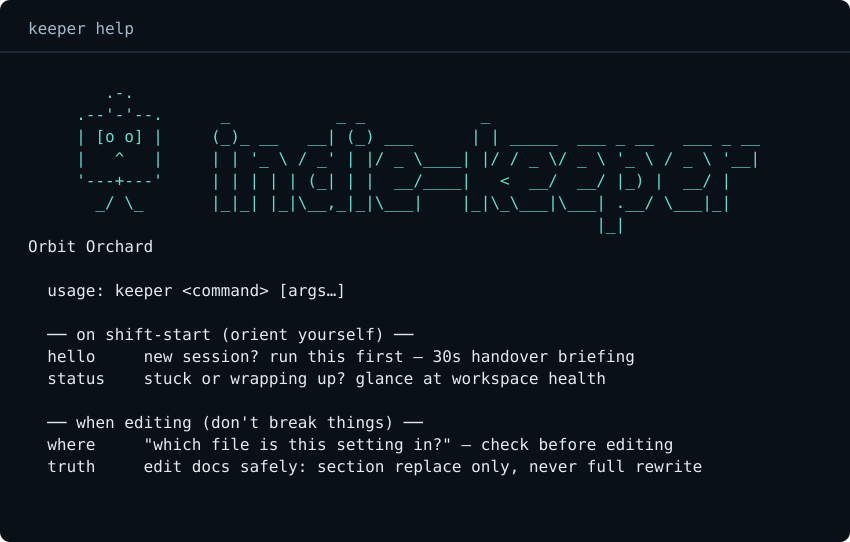
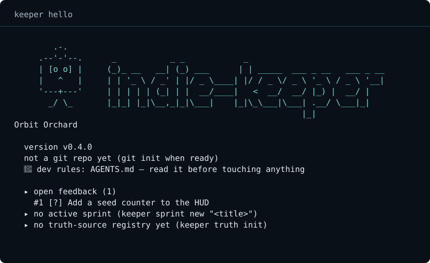
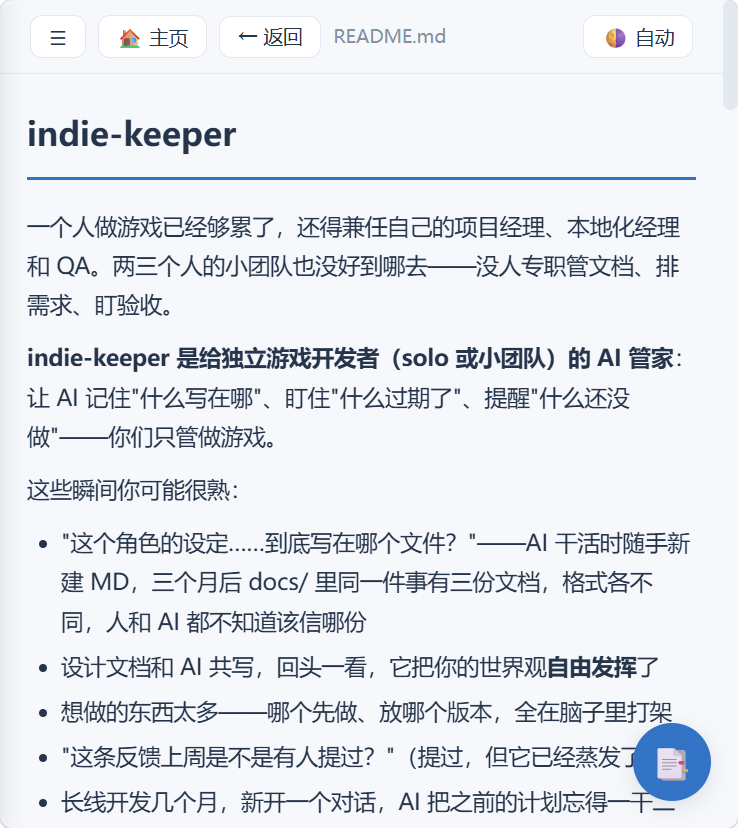
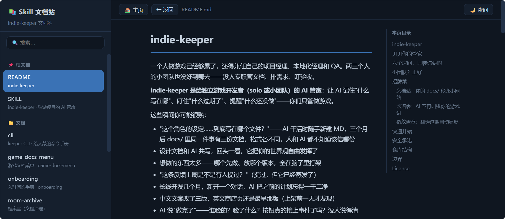

# indie-keeper

**[English](../../README.md)** | 中文

**indie-keeper 是给独立游戏开发者（solo 或小团队）的 AI 管家 Skill**。它给 AI 一份项目级记忆和一套可复用的工作流——文档保持整齐、反馈有据可查、翻译不再悄悄过期、发版有节奏。七个独立房间 + 项目骨架 + 写进 AGENTS.md 的通用规范，按需启用。零依赖（只要 Node.js）——AI 先问诊梳理一遍你的仓库，之后可以让 AI 继续接管，也可以当普通 CLI 自己敲。

## 这些瞬间，你熟吗？

一个人做游戏已经够累了，还得兼任自己的项目经理、本地化经理和 QA。两三个人的小团队也没好到哪去——没人专职管文档、排需求、盯验收。如果下面这些你也中过：

- "这个角色的设定……到底写在哪个文件？"——AI 干活时随手新建 MD，三个月后 docs/ 里同一件事有三份文档，格式各不同，人和 AI 都不知道该信哪份
- 设计文档和 AI 共写，回头一看，它把你的世界观**自由发挥**了
- 想做的东西太多——哪个先做、放哪个版本，全在脑子里打架
- "这条反馈上周是不是有人提过？"（提过，但它已经蒸发了）
- 长线开发几个月，新开一个对话，AI 把之前的计划忘得一干二净
- 中文文案改了三版，英文商店页还是最早那版（上架前一天才发现）
- AI 说"做完了"——谁验的？验了什么？按钮真的接上事件了吗？没人说得清

indie-keeper 就是冲这些来的。

## 它做什么

| 房间 | 解决什么 | 关键机制 |
|------|----------|----------|
| **档案室** | "这个设定写在哪个文件？" / AI 改文档互相覆盖 | 唯一权威登记 + 章节级小切口修改 + 死链/未登记检查 |
| **意见箱** | 反馈蒸发 / 计划只活在脑子里 | 每条反馈有编号有下落；成熟想法排进版本化的 ROADMAP |
| **WIKI** | 文档太多看不过来 / 规则文件散落各处 | docs/ 变成可搜索的小网站——双链、反链、夜间模式、单文件打包 |
| **文档翻译部** | 源文改了、译文过期没人发现 | 内容指纹让过期译文自动显形；发版前 CI 拦截 |
| **游戏文案部** | 游戏内硬编码文案 / 术语不统一 | 扫描硬编码字符串、管理术语表、逐条检测翻译漂移 |
| **发货口** | 版本号对不上 / 验收靠口头 / 发版手忙脚乱 | 一键多文件版本同步 + sprint 验收留痕 + 发布流水线（preflight 体检 + changelog + 平台指引） |
| **调度室** | "这个什么时候发？" / 没日期的计划悄悄滑 | 版本日期 + 工期预估；甘特图在 WIKI 里渲染 |

三条设计原则贯穿所有房间：**先问诊再动工**（绝不假设"标准做法"）；**渐进采用**（七个房间各自独立）；**约定而非关卡**（每个流程是默认值不是检查点——你说"这次就算过"，AI 就听你的）。

## 项目骨架与通用规范

除了七个房间，问诊时还会起一份**项目骨架**——根目录和 `docs/` 下的一小撮文档，让新人（人和 AI 都是）不用 grep 全仓库就能定位：

| 文档 | 用途 |
|-----|---------|
| `AGENTS.md` | AI 员工手册（技术栈、文件布局、约定、坑）——任何 AI 先读它 |
| `START-HERE.md` | 给人看的入口页（进展、待办决策、文档地图） |
| `docs/PLAN.md` | 当前 + 下个 sprint 任务清单 |
| `docs/PROGRESS.md` | 时间倒序的进展流水账 |
| `docs/DOCS-OVERVIEW.md` | 仓库文档地图 + 建议读顺序 |
| `docs/ARCHITECTURE.md` | 技术架构（模块 / 数据流 / 决策） |
| `docs/UIUX-SPEC.md` | UI/UX 架构（设计系统 / 交互 / 可访问性）——纯文字/CLI 项目可关 |

每个都能通过 profile 的 `entryDocs.*` 单独关掉。问诊时还会建立两项**通用规范**写进 `AGENTS.md`：**文件布局**规范（身份文档留根、状态文档进 `docs/`、脚本进 `scripts/`）和**测试**规范（按项目栈定命名 + 分层 + 维护规则——indie-keeper 不内置测试 runner，只帮你定适合你栈的约定）。

## 快速开始

**给 AI 用（推荐）**：把本仓库放进你的 AI 工具的 Skill/规则目录（Claude Code 的 skills、Cursor 的 rules 等——凡是能读 SKILL.md 的都行），然后对 AI 说：

> 用 indie-keeper 把我的项目管起来

AI 会先问诊再动工，绝不套死模板。

**当 CLI 用**：把 `scripts/` 拷进你的项目（建议 `tools/keeper/`），package.json 注册一行 `"keeper": "node tools/keeper/keeper.js"`。日常使用前仍需先过一轮问诊——让 AI 来（推荐），或照着问诊手册自己填。人类敲法完整手册：[中文 CLI 手册](../../references/cli.zh.md)。

不管走哪条路，首次使用都是**问诊**，不是安装向导：AI 先问清你的分工、平台、习惯（每题带建议和推荐值），答案存进 `keeper-profile.json`，之后所有房间按你的习惯办事。分工表里标了权威归属的领域（比如"世界观归你拍板"），AI 只组织和实现，**不自由发挥**。已有文档结构的老项目走"旧房改造"：先盘点登记，不推倒重来。

问诊后在终端输入 `keeper`，就能看到你的游戏名和接班时用得到的命令。



日常就三个动作：

```bash
keeper hello           # 每天开工：30 秒接班速查——新开对话 AI 失忆了？敲这个秒回状态
keeper where 角色      # 迷路时问："这个设定写在哪个文件？"——直达，不用全文搜
keeper status          # 睡前看一眼：工作区健康度
```

还有几个常用的：

```bash
keeper progress add "发了 v0.3"      # 往 docs/PROGRESS.md 追加一条
keeper plan done P-2                 # 把 PLAN.md 任务标 ✅
keeper start-here refresh            # 从 PROGRESS + 真相源刷新 START-HERE.md 的进展段和文档地图段
keeper schedule check                # 查 schedule.json 有没有重复 id / 悬空依赖 / 日期倒挂
```



输出默认英文，`--lang zh` 或 profile 里 `"language": "zh"` 切中文。

## 小团队？正好

这套东西不是 solo 专用，两三个人的小团队用起来更顺手：

- **分工写进档案**：问诊时登记谁管什么（"世界观归 A 拍板、代码归 B"），AI 从此知道该听谁的，不会拿着 B 的意见去改 A 的设定
- **需求有来源**：每条反馈都记着谁提的（`--from 美术` / `--from 试玩群`），半年后问"这需求当初谁要的"不用考古
- **验收有角色**：验收模式支持指定人点头才算过（`human`）或另一个 AI 交叉核验（`peer`），谁验的留痕在案
- **不跑代码的成员也能看文档**：`keeper site pack` 把全部文档打成**一个静态 HTML** 扔群里——策划、美术、写手手机上直接看，带搜索带目录，什么都不用装



## 招牌菜

### WIKI ：你的 docs/ 秒变小网站

`keeper site serve` 一敲，浏览器里就是一个完整的 WIKI ：

- **双链 + 反链**：`[[wiki 链接]]` 跨文档跳转，反链区显示"谁引用了这篇"——复杂结构里一眼找到关联文档
- **快速跳转**：侧栏按真实文件夹分组折叠（文档再多也能定位），纯数字文件名（如 sprint）自动用标题升级显示
- **本页目录 + 搜索**：长文档自动生成右侧大纲，全文搜索即时过滤侧栏
- **图片真渲染**：本地图片直接显示，`![[Obsidian 嵌入]]` 也认；`pack` 时图片内嵌 base64，离线单文件照样看图
- **白天/夜间/跟随系统**三态配色（夜间是不刺眼的黑蓝），顶栏 `🌐 中文` 一键切语言

`keeper site pack` 把整站打成**一个 HTML 文件**，扔进群里手机也能直接看。



**文档全部兼容 Obsidian**：`[[双链]]`、`[[目标|显示名]]`、frontmatter、`![[嵌入]]` 都是 Obsidian 同款语法。平时用 Obsidian 写作管理，发给别人用 WIKI——两边随便切，零迁移成本。

项目里的 AI 守则文件（`AGENTS.md`、`CLAUDE.md`、`.cursorrules`……)会被自动收录置顶——AI 员工手册当然要放在门口。

### 术语表：AI 不再叫错你的游戏词

你的游戏里行动资源不叫体力，叫**灵魂**？术语表就是"这个游戏的自造词典"：登记一次，AI 写任何面向玩家的文字前都先查它——不会突然冒出一句"体力不足"毁掉沉浸感。`glossary lint` 还能扫全部词典，抓出漏网的通用词。

### 指纹登记：翻译过期自动显形

每篇译文定稿时记下"基于哪一版源文"（内容指纹）。源文改了一个字，所有译文立刻显形为"过期"——`keeper docs status` 一看便知，发版前跑 `--check` 挡住带着过期翻译上架。游戏内文案同理（`keeper game drift`）。

### 发布流水线：每个不可逆步骤前先体检 *（新加，尚未长期验证）*

发版是小错叠加的地方：一个 `console.log` 混进 commit、一个凭证文件被暂存、版本号改漏一处。发布流水线在每个不可逆动作前跑 **preflight 体检**：

- `keeper release preflight commit` → 调试残留 / 凭证文件 / 已暂存 `.js` 跑 `node --check`
- `keeper release preflight push` → commit 全部检查 + 测试套件 + 落后远程 + 分支确认
- `keeper release preflight build` → 版本号一致 + 翻译同步 + sprint 验收 + 工作区干净 + release notes

问题（❌）拦截；警告（⚠️）提示。Preflight 绝不自动修——它告诉你哪里要改。配套 `keeper release changelog init/add/cut/show`（Keep a Changelog 格式）和 `keeper ver next`（从 conventional commits 自动算升级级别）。

平台指引（GitHub / itch / steam）**问诊时勾选才启用**——你确认了哪几个才装哪几个，CLI 绝不直接调 `gh`/`butler`/`steamcmd`，只打印命令。

> **诚实声明**：这套流水线在 v0.1.0 才落地，还没在真实项目长期跑过（包括本仓库自己）。机制是认真的，但会有粗糙的地方。欢迎反馈。

## 不是纸上谈兵

indie-keeper 本身就是用 indie-keeper 管的——这套文档的中英双语状态、sprint 验收、版本同步，全靠自家脚本跑。作者也用同一套理念和 CLI 管着自己的游戏 [Reverb.Exp](https://github.com/post090/Reverb.Exp)，从开发到上线——indie-keeper 就是从那套实战工具里提炼、泛化出来的。这里的每个机制都先在真项目里干过活。

## 安全承诺

治理文档的前提是不弄坏文档。[中文 Skill 手册](SKILL.zh.md) 写死了六条红线：永不删除原始文件、归档代替删除、破坏性操作逐项授权、修改走最小切口、绝不递归删除、动手前保证可回退。**红线优先于任何配置，AI 不得以任何理由违反。**

## 仓库结构

| 目录 | 内容 |
|------|------|
| [中文 Skill 手册](SKILL.zh.md) | 总纲：AI 上岗流程、房间速览、安全红线、行为守则 |
| [references/](../../references/) | 各房间机制手册 + 问诊手册 + CLI 人类手册 + 游戏文档推荐菜单 |
| [scripts/](../../scripts/) | 零依赖 Node 参考实现——`keeper.js` 入口 + `commands/`（房间命令）、`lang.js`（界面语言）和 `project-files.js`（登记表路径） |
| [templates/](../../templates/) | 数据文件模板 + 游戏设计文档骨架 + UIUX-SPEC 模板 |
| [docs/](../../docs/) | 文档 i18n manifest + 翻译指纹 + 根文档中文版（`docs/zh/`） |

> 作者自己的工作文档（ROADMAP / PLAN / PROGRESS / sprints / decisions——也就是本 Skill 给你项目播下的那套骨架）活在内部工作分支上，故意不进公开仓。吃自己的狗粮也包括“内部文档就该待在内部”这条。

## 边界

- 默认不绑定任何托管平台的私有做法；平台集成（GitHub / itch / steam）**问诊时勾选才启用**——CLI 绝不直接调 `gh`/`butler`/`steamcmd`，只打印命令
- 不碰凭据，token/密钥永不写进任何登记文件
- 不替你做产品决策——标了权威归属的领域，AI 只组织和实现，不自由发挥

## License

[MIT](../../LICENSE) · 拿去用，改成你自己的管家也行。
